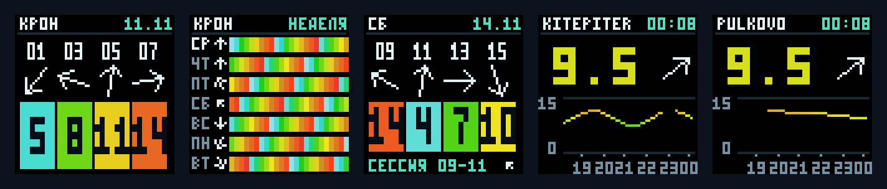

# WIND64 — табло ветра на ESP32

> **Важно: API Windy.app может плохо работать без VPN на роутере.**
> В проверенной домашней сети измерения станций загружались напрямую, а большой
> ответ прогноза иногда зависал или обрывался. VPN только на телефоне или
> компьютере не меняет маршрут самой ESP32. Перед покупкой и прошивкой проверьте
> API из той Wi-Fi-сети, к которой подключите табло: [проверка через браузер](docs/API-CHECK.md).

Открытый проект автономного табло **64×64** для
**Waveshare ESP32-S3-RGB-Matrix**. Прошивка написана на C++ и получает погоду
по Wi-Fi. Для настройки яркости достаточно браузера; компьютер нужен для
первоначальной записи и последующих обновлений по USB.

В репозитории находятся [исходники прошивки](firmware/wind64),
[браузерный прототип](wind64-prototype), тесты и инструкции.
Текущая версия прошивки — **1.1.2**. Данные — Windy.app, прогноз GFS27.
Проект независимый, не связан с Windy.app или Waveshare; доступность и формат
внешних погодных API могут изменяться.

## Как выглядит табло



На изображении — кадры программного рендера с демонстрационными данными,
а не фотография физической матрицы.

| Экран | Что показывает |
| --- | --- |
| Ближайшие часы | Четыре точки прогноза Крона с шагом два часа, включая ночь |
| Неделя | Ровно семь дней: сегодня и шесть следующих; по 24 часовых сегмента |
| Лучший день | Сильнейшая двухчасовая сессия среди семи дней начиная с завтра |
| KITEPITER | Фактический ветер, время измерения, график за шесть часов и частицы |
| PULKOVO | Измерения аэропорта Пулково в той же компоновке |

Каждый экран держится **10 секунд**, полный цикл — **50 секунд**.
Время всегда московское. Крон и обе станции фиксированы. Скорости — в м/с;
стрелки и частицы показывают, **куда дует ветер**.

## Что купить

| Компонент | Проверенный вариант | Количество |
| --- | --- | --- |
| Плата управления | [Waveshare ESP32-S3-RGB-Matrix](https://www.waveshare.com/esp32-s3-rgb-matrix.htm), 32 МБ Flash / 16 МБ PSRAM | 1 |
| Дисплей | [Waveshare RGB-Matrix-P3-64×64](https://www.waveshare.com/rgb-matrix-p3-64x64.htm), HUB75, 1/32 scan, шаг 3 мм, размер 192×192 мм | 1 |
| Блок питания | USB-C зарядка для телефона **27 Вт** — такой вариант подошёл автору проекта; питание устройства и панели должно быть **5 В** | 1 |
| Шлейф данных | 16-контактный HUB75, обычно есть в комплекте матрицы | 1 |
| Силовой провод | Кабель питания панели с разъёмом VH4, обычно есть в комплекте | 1 |
| Кабели USB | Кабель к зарядке и отдельный кабель **с передачей данных** для прошивки | По необходимости |
| Крепёж / корпус | Стойки, винты или рамка по месту установки | По желанию |

**О питании.** Надпись «27 Вт» не означает, что зарядка отдаёт всю эту мощность
при 5 В. Проверяйте её выходной профиль и кабель. Для панели P3 производитель
указывает **5 В / 4 А**; телефонная зарядка 27 Вт — опыт конкретной сборки,
а не гарантия работы любой зарядки на любой яркости. Не подавайте на панель
9 или 12 В. В [руководстве платы Waveshare](https://docs.waveshare.com/ESP32-S3-RGB-Matrix/Instructions-For-Use)
тоже приведён пример USB-C блока 27 Вт.

## Как подключить

При отключённом питании:

1. Соедините HUB75 платы с разъёмом **IN** матрицы. Соблюдайте ориентацию шлейфа.
2. Соедините силовой выход платы с силовым разъёмом матрицы отдельным проводом.
3. Подключите зарядку к разъёму **POWER** платы.
4. Для прошивки соедините разъём **USB** платы с компьютером кабелем данных.

HUB75 передаёт сигналы изображения; питание матрицы идёт отдельным проводом.
Проверьте полярность силового кабеля. После настройки табло работает автономно
от зарядки, без компьютера. SD-карта, динамик и дополнительные датчики для
этого проекта не нужны.

## Быстрый старт

1. [Проверьте API по Wi-Fi в браузере](docs/API-CHECK.md).
2. Скачайте [последний релиз](https://github.com/kirilldmt/espwind/releases/latest)
   или [соберите прошивку из исходников](firmware/README.md).
3. [Запишите прошивку по USB](firmware/README.md#запись-прошивки-по-usb).
4. При первом включении табло создаст сеть **WIND64-XXXX**. Цифровой
   восьмизначный пароль будет показан на матрице.
5. Подключитесь к этой сети и откройте **http://192.168.4.1**.
6. Введите данные домашней сети **2,4 ГГц**. После подключения верните телефон
   в домашнюю сеть и откройте **http://wind64.local**.

Точка настройки отключается через 15 секунд после успешного подключения.
При ошибке пароля прежние рабочие настройки сохраняются. Для повторной настройки
удерживайте **BOOT пять секунд на уже работающем устройстве**. Короткое нажатие
BOOT яркость не переключает.

## Яркость и диагностика

В той же Wi-Fi-сети откройте **http://wind64.local**. Если имя не определяется,
посмотрите IP табло в роутере и откройте его в браузере.

Значения по умолчанию: **80% днём**, **8% ночью**, ночь **23:00–07:00 МСК**.
На странице можно изменить уровни, расписание и режим. После нажатия
«Сохранить яркость» настройки сохраняются в памяти ESP32. Нулевая яркость
гасит экран, но оставляет веб-страницу доступной.

Для проверки получения погоды откройте **http://wind64.local/api/status**.
После первого подключения подождите 30–60 секунд. Ожидаются:
`forecastReady: true`, `kitepiterReady: true`, `pulkovoReady: true`, а у источников
в `polling` — `lastHttp: 200` и ненулевые `successes`.
Подробное объяснение — в [проверке API](docs/API-CHECK.md).

| Симптом | Что проверить |
| --- | --- |
| «НЕТ ВРЕМЕНИ» | Доступ в интернет и синхронизацию NTP |
| «НЕТ СЕТИ» | Wi-Fi и [доступность API](docs/API-CHECK.md); сохранённые данные продолжают стареть |
| «ЗАДЕРЖКА» | Возраст измерения: KITEPITER от 15 минут, PULKOVO от 60 минут |
| «УСТАРЕЛО» | Измерения старше 30/90 минут либо устаревший прогноз |
| Не открывается `wind64.local` | IP устройства, общую Wi-Fi-сеть, отсутствие изоляции клиентов |
| Экран чёрный | Питание, кабель матрицы и установленную яркость; при прошивке экран временно гаснет |
| Пароль WIND64 не подходит | «Забыть сеть» на телефоне и повторить с кодом с матрицы |

Прогноз обновляется раз в час, KITEPITER — раз в 5 минут, PULKOVO — раз в
15 минут. Паузы при ошибках увеличиваются. Переключение экранов не создаёт
новых погодных запросов. Погодный кэш находится в RAM и после отключения
питания загружается заново. Обновления выполняются по USB; OTA пока нет.

## Запустить прототип без ESP32

Нужен Node.js 20 или новее:

```sh
git clone https://github.com/kirilldmt/espwind.git
cd espwind/wind64-prototype
npm ci
npm start
```

Откройте **http://127.0.0.1:6464**. Прототип показывает пять экранов, позволяет
моделировать время, отсутствие сети и яркость, экспортировать PNG.
Для живых данных ему тоже нужен доступ к Windy.app.
Он слушает только локальный адрес компьютера. [Подробная инструкция](wind64-prototype/README.md).

## Разработка и лицензии

- [Сборка, установка и устройство прошивки](firmware/README.md).
- [Проверка API в браузере](docs/API-CHECK.md).
- [Проверенные сценарии и ограничения](docs/VERIFICATION.md).
- [Зависимости и лицензии](THIRD_PARTY_NOTICES.md).

Исходный код проекта распространяется по [лицензии MIT](LICENSE).
Лицензии сторонних компонентов и права на погодные данные действуют отдельно.
Пароль домашней сети вводится на самом устройстве после установки.
